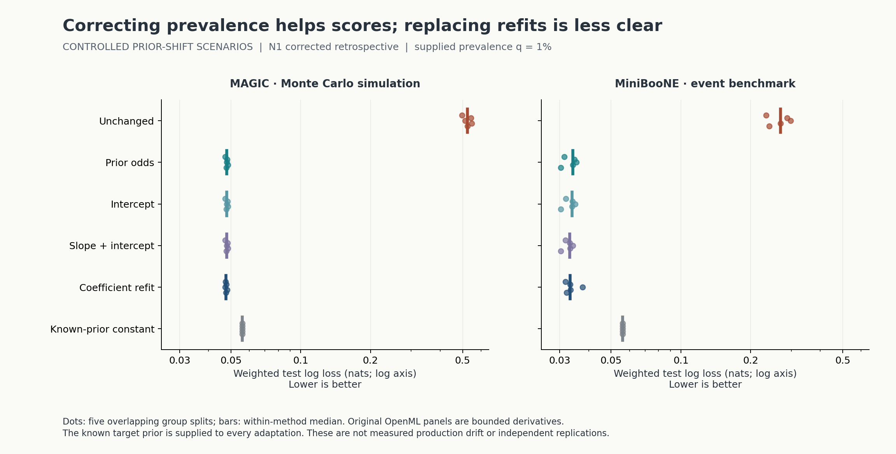
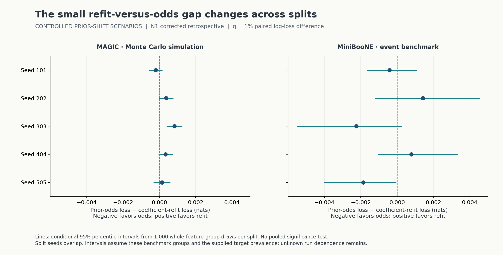
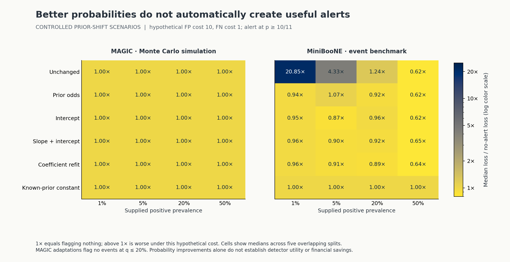

# Can a cheap probability correction replace a coefficient refit?

[Research manuscript: PDF and LaTeX](paper/README.md)



When positive events become rare, a probability adjustment can rescue an existing score without refitting its feature coefficients. This study asks whether that adjustment also matches a coefficient refit—and whether better probability scores produce useful alerts.

**The result is mixed.** At a supplied 1% positive prevalence, prior-odds correction improves test log loss substantially over unchanged scores. Against a fixed-penalty coefficient refit, it wins on **1/5 MAGIC splits and 3/5 MiniBooNE splits**. Eight of ten conditional intervals for that paired difference contain zero. All four MAGIC adaptations issue **no alerts at supplied prevalences up to 20%** under the declared false-positive cost 10/false-negative cost 1.

**Practical next step:** retain prior correction as a simple baseline, verify the source-calibration and stable-class-conditional assumptions, and validate the actual alert policy before replacing a model. These are **controlled prior-shift scenarios**, not measured production drift, a new calibration algorithm or a deployment recommendation.

**Evaluation status: corrected retrospective.** The original L-BFGS-B-only run passed independent arithmetic and Windows replay, but fresh Linux coefficients exceeded the fixed replay tolerance. [Correction N1](PROTOCOL.md#numerical-correction-n1-after-original-test-inspection) adds Newton stationarity polishing of the same convex objectives, retaining every original solver result and correction trial. The grid, splits, priors, costs and replay tolerance are unchanged; all ten selected penalties are unchanged. The [original Linux failure](results/corrections/original_linux_failure.json) and original Git history remain available. This reused test is not described as untouched.

## What was measured

Two exact OpenML derivatives: MAGIC Telescope v7 (Monte Carlo simulation) and MiniBooNE v6 (public event benchmark). Each panel contains 8,000 complete feature groups selected by hash after exact full-row deduplication. The variants differ in size and balance from the original UCI sources. Positive counts are 4,041 and 4,044. No private personal or clinical records are involved.

Five protected group splits, four supplied priors, six methods and every declared comparison are retained. The base ridge-logistic penalty is selected from six values using validation log loss. Six of ten winners hit the smallest grid value; a finite grid does not establish an optimum.

At **q = 1%**, medians across five overlapping splits are:

| Method | MAGIC log loss | MAGIC Brier MSE | MiniBooNE log loss | MiniBooNE Brier MSE |
|---|---:|---:|---:|---:|
| Unchanged | 0.524085 | 0.182740 | 0.269716 | 0.081670 |
| Prior odds | 0.047975 | 0.009690 | 0.034189 | 0.008582 |
| Intercept | 0.048006 | 0.009693 | 0.033928 | 0.008366 |
| Slope + intercept | 0.048007 | 0.009691 | 0.033107 | 0.008056 |
| Coefficient refit | 0.047615 | 0.009612 | 0.033274 | 0.008006 |
| Known-prior constant | 0.056002 | 0.009900 | 0.056002 | 0.009900 |

Log loss is in nats; lower is better. Brier score is probability MSE. These within-method medians are not paired differences or independent population replications. Full [metrics](results/test_metrics.json) and [summaries](results/summary.json) remain inspectable.



The median **paired** odds-minus-refit gap is +0.000344 nats for MAGIC and −0.000421 for MiniBooNE. Its sign changes across splits. Each interval uses 1,000 whole-group draws, mixing class means at the known target prior. Overlapping seeds and unknown event/run dependence prevent treating these as ten independent confirmatory tests.

## Probability scores and review decisions can disagree



Fixed hypothetical costs imply an alert threshold p ≥ 10/11 and loss 10×FP + FN per weighted scenario event. These are **analytical loss units, not dollars or measured detector costs**. Flagging nothing has loss q.

On MiniBooNE at q = 5%, prior odds has median loss **0.053404**, worse than the **0.05** no-alert reference, and exceeds it on three of five splits. Intercept recalibration and the refit have lower median loss, yet each also loses to that reference on two splits. No method or threshold was selected from these test outcomes.

## Independent evidence

- All **340 optimizer attempts** retain successful L-BFGS-B outputs, Newton correction traces and independent objectives, stationarity/box KKT, Hessian and directional finite-difference checks. Correction N1 requires a final projected-gradient residual at most **10⁻¹²** in fitting and **10⁻¹¹** under independent recomputation. Numerical convex-optimization certificates do not prove generalization.
- Standard-library CSV/struct parsing reconciles all **86,374 raw rows** and every selected value against SciPy ingestion; SQLite checks group partitions and class counts.
- Independent arithmetic reconstructs **71,706 validation logits**, **386,112 test predictions**, **240 metric rows**, **48 median cells** and **10,000 group-bootstrap draws**. Invalid missing-class draws are retained; none occurred in the study draws.
- Eight contracts cover held-target/feature isolation, exact prior weights, unchanged-prior odds identity, extreme logits, gradients/KKT, failed-attempt rejection, Newton convergence and invalid bootstrap draws.
- Original fits were frozen at `155b69c0bea4fd815b34d23b745810d471f9ea43` before initial test scoring. The corrected [model freeze](results/freeze.json) was committed at `49162586d96592f69b8787b241091c5df79a7048` before retrospective rescoring.

The refit uses the frozen penalty and scaler with all available fitting/validation/calibration labels; its penalty is **not retuned under the target mixture**. It is not the best possible fully retuned system. No slope/intercept hits a declared bound. Supplied priors, stable class-conditionals, the linear base family, duplicate-frequency changes, unknown run dependence, overlapping seeds and hypothetical costs remain limits. No production latency or financial impact is measured.

## Reproduce

Use Python 3.10 and the pinned packages:

```sh
python -m pip install -r requirements.txt
python -m unittest discover -s tests -v
python src/verify.py test
python src/verify_summary.py
python src/check_reproduction.py
```

The last command refits all models in a fresh temporary workspace, repeats independent checks and compares coefficients, predictions, metrics, summaries and resamples at **1e-7 absolute / 1e-9 relative** tolerance. Runtimes and iteration/evaluation counts are retained, not cross-machine equality targets. See [replay evidence](results/reproduction.json), [numerical checks](results/INDEPENDENT_TEST_CHECK.json), [summary checks](results/INDEPENDENT_SUMMARY_CHECK.json) and [the protocol](PROTOCOL.md).

To reacquire and reconcile original downloads, run `python src/fetch.py` then `python src/verify_sources.py`. Raw ARFF stays ignored. A clean exact-head Linux full replay is required before this study is counted as released.

## Sources and established methods

[Data attribution](DATA_ATTRIBUTION.md) and [the exact manifest](data/manifest.json) retain versions, source links, hashes and changes. Original UCI CC BY4.0 attribution is preserved for R. Bock's MAGIC and Byron Roe's MiniBooNE despite different OpenML license fields.

[Saerens, Latinne and Decaestecker (2002)](https://doi.org/10.1162/089976602753284446) describe output adjustment under new priors, including unknown-prior estimation; this known-q experiment does not reproduce their EM procedure. [Alexandari, Kundaje and Shrikumar (2020)](https://proceedings.mlr.press/v119/alexandari20a.html) examine calibration and label-shift adaptation. [SciPy 1.15.3](https://docs.scipy.org/doc/scipy-1.15.3/reference/optimize.minimize-lbfgsb.html) documents the solver stopping rules. This is an independently executed comparison, not a claimed novel method or established research gap.

**Visibility:** original code, permitted benchmark derivatives, figures and reproducible results are public. Source papers, credentials and private records stay out of Git history. The independent [research manuscript](paper/README.md) is shared on GitHub and has not been peer reviewed. This example demonstrates research work and does not imply production deployment or employer experience.
